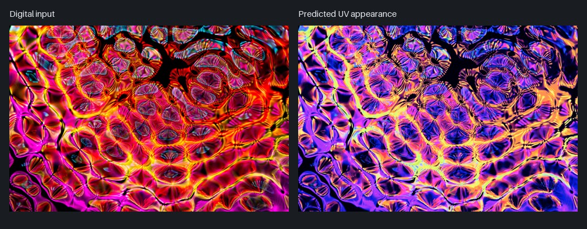
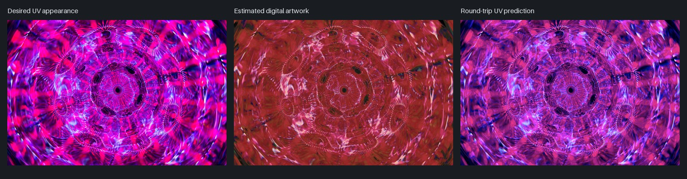

# Conversion examples

Source photographs by **Merlin Lightpainting**, used under the [Pexels License](https://www.pexels.com/license/). See [asset notices](../ASSET_NOTICES.md) for the original photo pages and license scope.

| Example | Source | Views |
| --- | --- | --- |
| Abstract light art | [Original JPEG](sources/abstract-light-art.jpg) · [Pexels page](https://www.pexels.com/photo/abstract-light-art-14146747/) | UV target, estimated digital, forward UV conversion, and round-trip UV preview |
| Round shapes | [Original JPEG](sources/round-shapes.jpg) · [Pexels page](https://www.pexels.com/photo/colorful-abstract-illustration-with-round-shapes-14367716/) | Digital input and predicted UV appearance |





These are screen previews of model transformations, not measured physical prints. Documentation images are resized JPEG previews and should not be used as print artwork. The app exports full-size, lossless RGB PNGs. Original full-size converted examples remain in the ignored local `full-resolution/` folder.

Regenerate the documentation previews locally with:

```powershell
.\.venv\Scripts\python.exe -m tools.prepare_examples
```

That command requires the local full-resolution outputs. To generate new outputs from an input instead, open a source JPEG in the app, select the intended conversion direction, and export.
