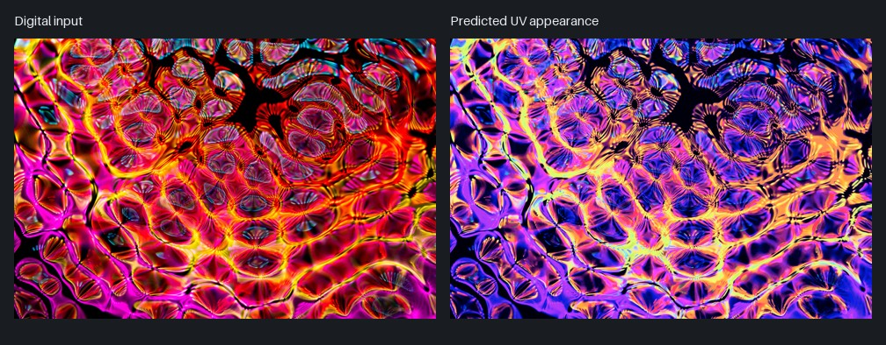
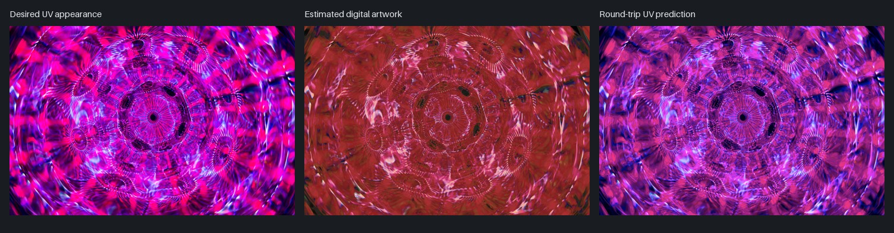

# Digital to UV Print Converter

Prepare RGB artwork for UV/blacklight printing. Convert a desired UV appearance into estimated digital artwork, preview digital artwork under the reference UV model, and inspect where colors are likely to differ.

## Download — Windows x64

**[Download the standalone v0.2.0 executable](https://github.com/The-ai123/digital-to-uv-print-converter/raw/refs/heads/main/dist/Digital%20to%20UV%20Print%20Converter%200.2.0.exe)**

Download that file and double-click it. No Python installation, terminal, batch file, or separate installer is required. The executable includes the reference profile, precomputed lookup tables, and GPU bindings. `dist/` contains only the current executable.

The profile is a screenshot-derived approximation, not a measured production calibration. Validate production artwork with a physical proof under the intended UV setup.

## Use the app

1. **Open image…** and select the image representing your desired UV appearance.
2. Leave **Blacklight → digital** selected. For the opposite workflow, choose **Digital → blacklight**.
3. Leave **Compute** on **Auto**, confirm the profile, and click **Convert**.
4. Inspect the digital artwork and diagnostics. **Round-trip preview** shows the UV appearance predicted from the estimated digital artwork.
5. **Export PNG + heatmap…** saves the artwork and a separate diagnostic folder. Edit problem colors in the input and repeat as needed.

| Direction | Input | Output |
| --- | --- | --- |
| Blacklight → digital | Desired UV appearance | Estimated digital artwork for print preparation |
| Digital → blacklight | Digital print artwork | Predicted UV appearance |

**Load profile…** selects a different calibration. **Open reference chart** opens the redesigned digital swatches. The status bar shows progress, the current phase, and elapsed time. Keyboard shortcuts include Ctrl+O to open, Ctrl+Enter to convert, Ctrl+S to export, and F1 for model details.

## Exports and diagnostics

Exports use three-channel **8-bit sRGB PNG** with lossless compression. For `artwork.png`, diagnostics are written beside it in `artwork_analysis/`; repeated exports create new numbered diagnostic folders.

| File | Purpose |
| --- | --- |
| `artwork.png` | Converted artwork |
| `loss-heatmap.png` | RGB mismatch after converting out and back |
| `loss-overlay.png` | Mismatch highlighted over the original image |
| `predicted-uv.png` | UV prediction of the estimated digital artwork |
| `calibration-coverage.png` | Distance from input colors to colors sampled by the profile |
| `report.json` | Metrics, legend, backend/device, and limitations |

For Digital → blacklight, the simulation is named `recovered-digital.png`. **Save project…** preserves the normalized original, conversion, profile, and diagnostics. **Restore original…** recovers the normalized original RGB pixels.

**Heatmap scale:** blue 0%, cyan 2%, yellow 5%, red 10%+ RGB mismatch. Red indicates a large mismatch in the fitted round trip; it does not prove a color is physically impossible. Check calibration coverage too: an internally consistent model can still be inaccurate away from its samples.

PNG storage is lossless; color mapping, gamut clipping, transparency compositing, and 8-bit normalization are not mathematically reversible. See the [technical reference](docs/technical-reference.md) for metric definitions, calibration, file handling, and limitations.

## Examples

Example photographs by **Merlin Lightpainting**, used under the [Pexels License](https://www.pexels.com/license/). Images below are resized documentation previews, not print-ready exports or physical print photographs.

Digital input → predicted UV appearance:



Desired UV appearance → estimated digital artwork → round-trip UV prediction:



[Example inputs and credits](Examples/README.md) · [Asset notices](ASSET_NOTICES.md)

## Hardware and performance

- **Auto:** OpenCL GPU for larger images, with native CPU fallback.
- **GPU (OpenCL):** explicitly requires a working OpenCL GPU/runtime.
- **CPU:** uses Pillow's compiled LUT implementation.

Compatible Intel, AMD, and NVIDIA GPUs can use OpenCL when supported by their installed drivers. Only Intel Iris Xe has been verified for this project. The app does not install or change graphics drivers.

GPU processing accelerates the full-image color and coverage lookup passes. Diagnostics, color-profile handling, new calibration fitting, and PNG encoding still use the CPU. Accelerated interpolation may round differently from the float64 reference; PNG compression preserves the resulting values exactly.

A local 12-megapixel synthetic-image check on Iris Xe measured conversion plus diagnostics at about 7 seconds, excluding export. One mapping pass took about 27 seconds with the original NumPy implementation, 1.3 seconds with native CPU, and 0.8 seconds with OpenCL. Results depend on image, hardware, and profile.

Custom tables are cached in `%LOCALAPPDATA%\DigitalToUVPrintConverter\cache` for the executable. Input artwork is not stored in the cache. First-time custom profiles may take longer. Progress is phase-based completed work, not a remaining-time estimate; PNG exports advance as each file completes.

## Run from source

Python 3.11+ with Tkinter is required. From the repository root:

```powershell
python -m venv .venv
.\.venv\Scripts\python.exe -m pip install -r requirements.txt
.\.venv\Scripts\python.exe uvconvert.py gui
```

For optional GPU support in a source environment:

```powershell
.\.venv\Scripts\python.exe -m pip install -r requirements-gpu.txt
```

Command-line conversion:

```powershell
.\.venv\Scripts\python.exe uvconvert.py convert desired-uv.png digital-artwork.png --direction to-digital --profile charts/reference-profile.json --backend auto
```

Omitting `--profile` in the CLI uses the synthetic demo, unlike the GUI's bundled chart profile. Use `--no-analysis` to export only the converted PNG.

## Project layout

```text
dist/                    Current standalone Windows executable only
charts/                  Redesigned charts and sampled RGB profile/data
Examples/sources/        Licensed example input photographs
Examples/previews/       Small documentation comparisons
assets/calibration/      Generated RGB calibration chart and template
docs/                    Technical documentation
tools/                   Packaging and asset-preparation utilities
tests/                   Numerical, format, and backend checks
uvconvert.py             RGB processing and CLI
uv_gui.py                Desktop interface
desktop.py               Standalone executable entry point
image_backend.py         OpenCL GPU and native CPU mapping
loss_analysis.py         Loss/coverage diagnostics and export
```

Build intermediates, caches, diagnostic runs, full-resolution example exports, and original reference-chart photos stay local and are ignored by Git. Full-resolution examples are preserved in `Examples/full-resolution/`; original chart material is preserved in `local-reference/`.

Build the standalone executable:

```powershell
.\.venv\Scripts\python.exe -m pip install -r requirements-build.txt
.\.venv\Scripts\python.exe -m tools.build_windows
```

Checksums and build metadata are written to `build/release/0.2.0/`, keeping `dist/` limited to the executable. The build removes older versions of this application's executable after a successful build.

Run the provided automated checks manually:

```powershell
.\.venv\Scripts\python.exe -m unittest discover -s tests -v
```

The GPU path has been checked numerically and benchmarked. The packaged desktop application has not been launched or visually tested through automation.

## License

Application source code: [MIT](LICENSE). Example photographs retain the [Pexels License](https://www.pexels.com/license/). Third-party assets and runtime libraries retain their own rights and licenses; see [asset notices](ASSET_NOTICES.md).
